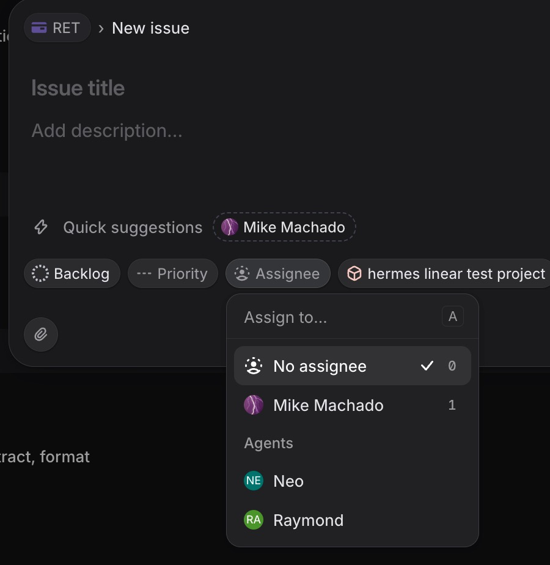
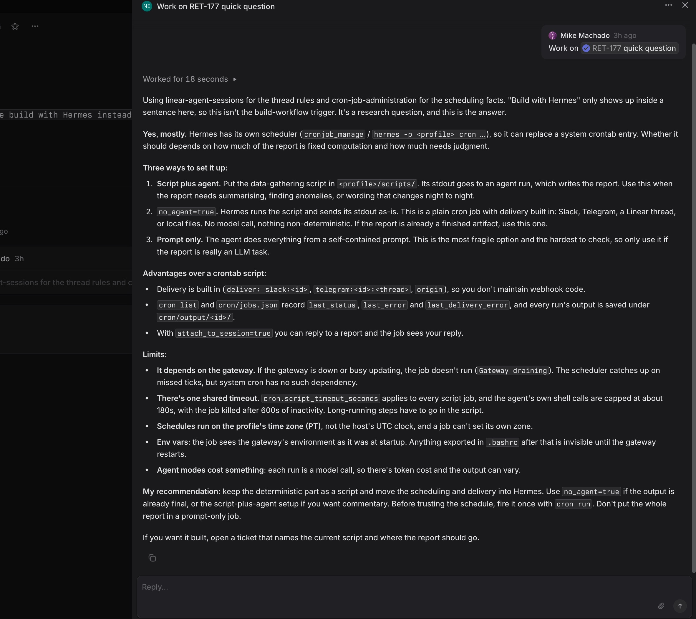
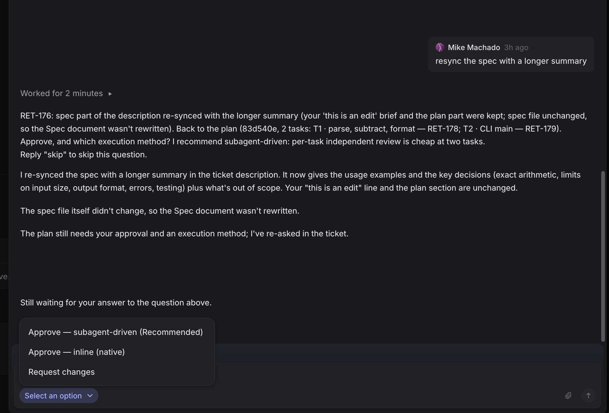
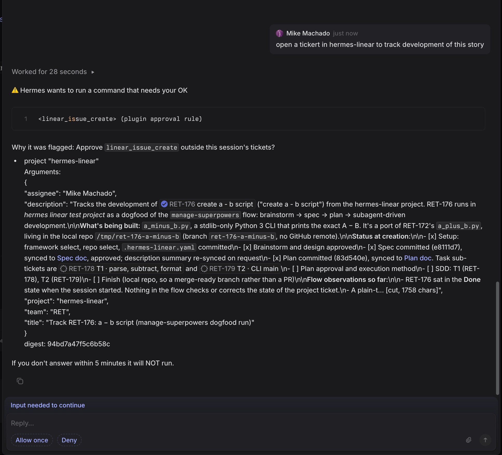

# Hermes Linear Channel

A [Hermes Agent](https://github.com/NousResearch/hermes-agent) channel plugin that turns Linear into a place you work *with* your Hermes agent:

- **Delegate a ticket to your agent → one Hermes session for the whole ticket.** The agent works in the thread Linear opens on delegation (and in any thread where you @mention it). Plain comments from your team and edits to the ticket and its project reach the same conversation as context, so the agent remembers everything about the ticket.
- **@mention your agent on any other ticket → a quick, thread-scoped Q&A.** Follow-ups in that thread keep context; nothing is shared ticket-wide.
- **Native Linear agent UI:** progress (thoughts and tool calls), approvals and questions as pick-lists, the Stop button, and a live plan checklist.
- **Build with hermes: [superpowers](https://github.com/obra/superpowers) inside a ticket.** Start a delegated ticket's description with "Build with hermes." and the agent runs the superpowers method (brainstorm → spec → plan → subagent-driven development) in the ticket thread: design questions as pick-lists, the spec and plan as Linear documents, one `T<n> · <name>` sub-ticket per task. It needs the superpowers plugin; see [Without superpowers](#without-superpowers).

It runs inside *your* Hermes and connects to *your* Linear workspace through a Linear OAuth app you create. Nothing is hosted by anyone else.

This is a community plugin. I am not affiliated with Linear (linear.app), and this is not an official plugin from Linear.

---

## Contents

- [Screenshots](#screenshots)
- [How it behaves](#how-it-behaves)
- [Agent tools](#agent-tools)
- [Requirements](#requirements)
- [Without superpowers](#without-superpowers)
- [Install](#install)
- [Create the Linear OAuth app](#create-the-linear-oauth-app)
- [Expose the webhook](#expose-the-webhook)
- [Configure the plugin](#configure-the-plugin)
- [Web dashboard](#web-dashboard)
- [Configuration reference](#configuration-reference)
- [Multiple Hermes profiles](#multiple-hermes-profiles)
- [Access control](#access-control)
- [CLI](#cli)
- [Troubleshooting](#troubleshooting)
- [Security notes](#security-notes)
- [What it touches](#what-it-touches)
- [Limitations](#limitations)
- [Development](#development)
- [License](#license)

---

## Screenshots

Your agent appears under **Agents** when you assign or delegate a ticket:



Its replies, progress and questions show up in Linear's agent panel:



Questions, such as a superpowers plan approval, are pick-lists in the thread:



A write outside the ticket asks first, with **Allow once** / **Deny**:



---

## How it behaves

| You do in Linear | What happens |
|---|---|
| Delegate a ticket to the agent | A Hermes session opens for the ticket. The agent acknowledges within seconds, moves the ticket to your team's first *started* status (configurable) and gets to work. |
| Reply in the agent's thread | The reply is the next turn in the ticket's session. |
| Comment on a delegated ticket without @mentioning the agent | The agent doesn't wake up. It sees the comment in a "Since your last turn" summary on its next turn. |
| Edit the ticket or its project | Same as a plain comment: recorded, then summarized on the next turn. |
| @mention the agent in another thread on a delegated ticket | The agent answers there, in the same ticket session. |
| @mention the agent on a ticket that isn't delegated | A one-off session for that thread only. |
| Press **Stop** | The running turn stops, and the agent says what it finished. |
| Answer an approval or question pick-list | The agent carries on. Free text never counts as approving a risky action. |
| The agent wants to write outside its ticket tree | It asks with an **Allow once / Deny** pick-list first. See [Write scope](#write-scope). |
| Ask the agent in Slack, Telegram, the CLI or cron to change a ticket | Hermes asks in that chat first. See [Outside a Linear session](#outside-a-linear-session). |
| Remove the delegation | Any running turn stops. Re-delegating resumes the same session, unless the ticket is Done or Canceled. |

Tool calls show up in Linear's agent panel as actions, commentary as thoughts, and the final answer as a comment in the thread. Prompts that arrive together (from two threads, say) run one after the other.

## Agent tools

The tools act as the Linear app, so every write is attributed to it. On failure they return `{"ok": false, "error": "<CODE>"}`; they don't raise.

| Tool | What it does |
|---|---|
| `linear_issue_get` | Read any issue: fields, relations, attachments, documents, and with `comments: N` the newest N comment threads. |
| `linear_search` | Find issues by text, or filter by team, project, state, assignee, delegate, label or parent. Paged. |
| `linear_issue_create` | Create an issue with any of the usual fields. It lands in the parent's team and project, or the session ticket's. |
| `linear_issue_update` | Change an issue's fields, parent or project. `null` clears a field. Issues can't move between teams. |
| `linear_comment` | Comment on an issue, reply in a thread (`reply_to`), resolve a thread, or edit the app's own marked comment. |
| `linear_relation` | Add a `blocks`, `blocked_by`, `related` or `duplicate_of` relation between two issues. |
| `linear_attach` | Upload a local file or link a URL (a GitHub PR becomes a PR attachment) to an issue, or upload a file to embed in a comment. |
| `linear_session_link` | Show a link, usually the PR, on the agent session. |
| `linear_document` | Read, create or edit a Linear document on an issue or project. |
| `linear_project` | Read a project, post a project update with a health status, create or edit a milestone, or add a link. |
| `linear_lookup` | List valid teams, states, labels, users, cycles, projects or milestones. |
| `linear_query` | Run any read-only GraphQL query. Mutations are refused. |
| `linear_sync_spec` | Copy a committed spec file to a `Spec:` document on its ticket and put the agent's summary in the description, below the original brief. |
| `linear_sync_plan` | Same for a plan, plus one `T<n> · <name>` sub-ticket per task. The ticket IDs are written back into the plan file. |
| `linear_task_state` | Move a task sub-ticket to in progress, in review, done or blocked. |

### Write scope

Inside a Linear session the agent writes freely to its own ticket tree and asks before touching anything else.

- It writes without asking to the session ticket, its sub-tickets, and tickets and documents it created from that ticket. The plugin remembers what it created across restarts.
- Anything else asks first: a comment, edit, relation or attachment on another issue, a create in another team or project, a document outside the tree, and every `linear_project` write (the ticket's own project included). You get an **Allow once / Deny** pick-list in the thread, and nothing is written until you allow it. `out_of_scope_writes` (`approve`, `deny` or `allow`) changes this.
- *Allow once* covers that one call. If nobody answers before Hermes's `approvals.timeout`, the question stays open in the thread, and answering it later runs the call.
- `linear_sync_spec`, `linear_sync_plan` and `linear_task_state` only work on the session ticket's tree.
- Reads work on anything, from any session, without asking.
- Nothing is ever deleted.

### Names and fields

The write tools take names instead of UUIDs: a team key, a project or milestone name, a user's name or email (`me` is the app), a cycle number or `current` / `next`, and a state name or type.

- A name that doesn't match returns an error such as `TEAM_NOT_FOUND` or `PROJECT_NOT_FOUND`, with candidates to pick from. An unknown label returns `LABEL_MISSING` with the labels that exist.
- `linear_lookup` lists the valid names for a team or project.
- `priority` is `urgent`, `high`, `medium`, `low` or `none`. `due_date` is `YYYY-MM-DD`.

### Delegation

Only a person can delegate a ticket to this app.

- `delegate` can name another agent. Naming this app fails with `SELF_DELEGATION`: Linear would open a session with no creator, and the plugin would reject it with an error on the ticket.
- `assignee` can't be an app (`ASSIGNEE_IS_APP`), because Linear turns an app assignee into a delegation.

### Outside a Linear session

The tools also work from Slack, Telegram, the CLI and cron. There, every write follows `outside_session_writes`:

- `approve` (default): Hermes asks in that chat before each write.
- `deny`: writes are refused with `NOT_LINEAR_SESSION`.
- `allow`: writes go through without asking.

There is no ticket tree outside a session, so every issue counts as out of scope there, including ones created from that chat. `linear_issue_create` without a `parent` or `team` uses the `default_team` and `default_project` settings. Issues and comments written from outside a session end with `Filed by <profile> via <platform>`. The sync tools, `linear_task_state`, `linear_session_link` and `linear_attach` with `embed` need a Linear session.

### Attachments

`linear_attach` uploads a local file only if Hermes would also send it as media to another channel (its `validate_media_delivery_path` check).

- Refused with `PATH_DENIED`, with no approval possible: `.env` files, `~/.ssh`, `~/.aws` and other credential dirs, system dirs such as `/etc`, and Hermes's own config and state.
- Any other file passes in the default mode, so a credential file outside those dirs (`~/.netrc`, say) gets through. Strict mode (`gateway.strict: true` or `HERMES_MEDIA_DELIVERY_STRICT=1`) only allows Hermes's cache dirs, `HERMES_MEDIA_ALLOW_DIRS` and freshly produced files.
- Files over 50 MB are refused.
- Attaching the same file twice uploads it twice, and Linear's API can't delete uploads. Linking the same URL twice returns `ALREADY_LINKED`.
- A file named with `MEDIA:` in a final reply is shown by name and never uploaded.

## Requirements

- Hermes Agent v0.23.2 or newer, with the gateway running (`hermes gateway run` or the systemd service).
- A Linear workspace where you can create an OAuth application (workspace admin).
- A way for Linear to reach your machine over HTTPS: Tailscale Funnel, Cloudflare Tunnel, ngrok, or a reverse proxy on a public host. See [Expose the webhook](#expose-the-webhook).

## Without superpowers

The [superpowers](https://github.com/obra/superpowers) plugin is optional. Without it you lose the managed workflow; everything else works the same.

**Works without it:** delegation and @mention sessions, the "Since your last turn" context digest, progress in the agent panel, questions and approvals as pick-lists, Stop, and every `linear_*` tool. The tools are deferred behind tool search (load with `tool_describe`, call with `tool_call`), and the agent can use them on any ticket it works.

**Needs it:** the *build with hermes* flow (a ticket whose description starts with "Build with hermes."). It is built on the superpowers method and runs brainstorm → spec → plan → subagent-driven development inside the ticket, with automatic `T<n> · <name>` task sub-tickets, their status updates, and large-project decomposition into sub-project tickets. When a ticket asks for that flow and superpowers isn't installed, the agent says so in the thread and works the ticket directly instead.

`linear_sync_spec`, `linear_sync_plan` and `linear_task_state` don't need superpowers either. They read the markdown format: a `Linear: <ID>` header line and `### Task N: <name>` headings. A hand-written spec or plan in that shape syncs the same way.

## Install

```bash
hermes plugins install masha256/hermes-linear   # pin with --ref <commit-sha> for reproducible installs
hermes plugins enable linear
```

Third-party plugins are disabled until you enable them.

Both commands act on the current profile only. For another profile, add `-p <profile>` (see [Multiple Hermes profiles](#multiple-hermes-profiles)).

## Create the Linear OAuth app

Create **one app per Hermes profile** you want in Linear. The app's name and icon are how the agent appears in Linear (mention menu, assignee/delegate menu), so pick something short and recognisable.

1. In Linear go to **Settings → API → Applications → New application** (<https://linear.app/settings/api/applications/new>).
2. Fill in **Name**, **Icon**, and **Developer URL**. If Linear asks for a **Callback URL**, any HTTPS URL on your host works (e.g. `https://<your-host>/linear/oauth/unused`) — the plugin doesn't use the browser OAuth flow.
3. **Enable client credentials** for the app. The plugin uses client-credentials tokens (30-day, app identity, no browser sign-in).
4. **Enable webhooks** and set the URL to your profile's webhook URL:
   ```
   https://<your-host>/linear/<hermes-profile>/webhook
   ```
   For a single-profile install, `<hermes-profile>` is `default`.
5. Tick these webhook categories:
   - **Agent session events** — required; this is what turns the app into an agent
   - **Issues**
   - **Comments**
   - **Issue attachments**
   - **Projects**
   - **Project updates**

   *Issue labels* and *Project labels* are not needed (they describe label definitions; labels applied to a ticket arrive with Issues).
6. Save, then copy the **Client ID**, **Client secret**, and **Webhook signing secret**.
7. Team access: client-credentials tokens can reach all **public** teams. To use the agent in a private team, add that team on the app's page under **Settings → Applications**.

The plugin requests the scopes `read, write, app:mentionable, app:assignable`.

## Expose the webhook

The plugin runs one local listener (default `127.0.0.1:8650`) shared by every profile in the gateway, with a single route: `POST /linear/<profile>/webhook`. A profile that sets its own `listener_host`/`listener_port` gets a separate listener there. Linear must reach it over public HTTPS. Any tunnel or proxy works as long as it forwards to the listener **with the path unchanged**. Forwarding only `/linear/` is enough; nothing else is served.

Your webhook URL is always `https://<public_host>/linear/<profile>/webhook`. `hermes linear setup` asks for `public_host` (it suggests your Tailscale name when Tailscale is installed; overwrite it for any other option) and prints the exact URL.

No extra auth is needed at the tunnel: every webhook is HMAC-signed and rejected if older than 60 s.

| Option | Setup | Stable URL | Needs your own domain | Notes |
|---|---|---|---|---|
| [Tailscale Funnel](#tailscale-funnel) | One command | Yes | No | Ports 443, 8443, 10000 only; URL carries the port. |
| [Cloudflare Tunnel](#cloudflare-tunnel) | Moderate | Yes (named tunnel) | Yes, on Cloudflare DNS | No open ports; quick tunnels are testing-only. |
| [ngrok](#ngrok) | One command | Yes (dev domain) | No | Free plan: one static dev domain. |
| [Reverse proxy on a public host](#reverse-proxy-on-a-public-host) | Most work | Yes | Yes | VPS or public IP; Caddy handles TLS. |

### Tailscale Funnel

Publish the listener under the `/linear/` path:

```bash
tailscale funnel --bg --https=8443 --set-path /linear http://127.0.0.1:8650/linear
tailscale funnel status
```

- Funnel only serves ports **443, 8443, 10000**. Pick one not already used by `tailscale serve`.
- If your tailnet hasn't enabled Funnel yet, the command prints an enable link — open it once.
- `public_host` is `<machine>.<tailnet>.ts.net:8443`, so the webhook URL is `https://<machine>.<tailnet>.ts.net:8443/linear/<profile>/webhook`.
- To stop exposing it: `tailscale funnel --https=8443 off` (this turns off everything on that port).

### Cloudflare Tunnel

Use a **named tunnel** on a domain whose DNS is on Cloudflare. `cloudflared` connects outbound, so no inbound ports are opened. See Cloudflare's [locally-managed tunnel guide](https://developers.cloudflare.com/cloudflare-one/connections/connect-networks/do-more-with-tunnels/local-management/create-local-tunnel/) for installing `cloudflared`.

```bash
cloudflared tunnel login                       # once; opens a browser to pick the zone
cloudflared tunnel create hermes               # prints the tunnel UUID and credentials file
cloudflared tunnel route dns hermes hermes.example.com
```

`~/.cloudflared/config.yml`:

```yaml
tunnel: <tunnel-uuid>
credentials-file: /home/<you>/.cloudflared/<tunnel-uuid>.json
ingress:
  - hostname: hermes.example.com
    path: ^/linear/
    service: http://127.0.0.1:8650
  - service: http_status:404
```

```bash
cloudflared tunnel run hermes                  # foreground, to test
sudo cloudflared service install               # then run it as a service
```

- `public_host` is `hermes.example.com` (no port); the webhook URL is `https://hermes.example.com/linear/<profile>/webhook`.
- The service reads its config from `/etc/cloudflared/` when installed as root; copy `config.yml` and the credentials file there if it can't find them. See [run as a service](https://developers.cloudflare.com/cloudflare-one/connections/connect-networks/do-more-with-tunnels/local-management/as-a-service/).
- **Quick tunnels** (`cloudflared tunnel --url http://127.0.0.1:8650`) give a random `*.trycloudflare.com` URL that changes on every restart, so you'd re-edit the Linear app each time. Testing only.

### ngrok

Every ngrok account, free included, gets one static **dev domain** (e.g. `your-name.ngrok-free.dev`; find it under *Domains* in the ngrok dashboard). Paid plans can use a reserved or custom domain via `--url`.

```bash
ngrok config add-authtoken <token>             # once
ngrok http 8650 --url your-name.ngrok-free.dev # foreground, to test
```

To keep it running, define the endpoint in the agent config (`ngrok config edit`):

```yaml
version: 3
agent:
  authtoken: <token>
endpoints:
  - name: hermes-linear
    url: https://your-name.ngrok-free.dev
    upstream:
      url: 8650
```

```bash
sudo ngrok service install --config /home/<you>/.config/ngrok/ngrok.yml
sudo ngrok service start
```

`ngrok config check` prints the config file's path if yours lives elsewhere (macOS: `~/Library/Application Support/ngrok/ngrok.yml`).

- `public_host` is `your-name.ngrok-free.dev` (no port).
- The free plan's browser warning page is shown to browsers only; Linear's webhook requests are not affected.
- This exposes the whole listener port, not just `/linear/`. That is fine (the listener serves nothing else); restrict it with an ngrok traffic policy if you want.

### Reverse proxy on a public host

If you have a VPS or a machine with a public IP and a DNS name, put [Caddy](https://caddyserver.com/) in front of the listener; it obtains and renews the TLS certificate itself. `Caddyfile`:

```caddyfile
hermes.example.com {
	handle /linear/* {
		reverse_proxy 127.0.0.1:8650
	}
	respond 404
}
```

- Hermes on the same host: done. `public_host` is `hermes.example.com`.
- Hermes behind NAT (home box) and Caddy on a VPS: carry the listener port over SSH from the Hermes machine, and keep it up with `autossh` or a systemd unit:

  ```bash
  ssh -N -o ServerAliveInterval=30 -o ExitOnForwardFailure=yes \
      -R 127.0.0.1:8650:127.0.0.1:8650 you@vps.example.com
  ```

- nginx or any other proxy works the same way: TLS termination, forward `/linear/` to the listener, path unchanged.

Not recommended: ad-hoc tunnel services with random URLs or interstitial pages (localtunnel and similar). A changing URL means re-editing the Linear app, and an interstitial breaks delivery.

## Configure the plugin

Easiest: run the wizard and follow the prompts.

```bash
hermes linear setup            # or: hermes gateway setup → Linear
# for another profile (install the plugin there first, see Multiple Hermes profiles):
hermes -p <profile> linear setup
```

The wizard stores secrets in the profile's `.env`, other settings in the profile's `config.yaml`, prints the webhook URL, and runs a live check. Restart the gateway afterwards. Its step 3 prints a Tailscale Funnel command; skip it if you expose the webhook another way.

Manual setup is equivalent:

```bash
hermes config set plugins.entries.linear.settings.client_id <client-id>
# secrets go in the profile's .env (never in config.yaml):
#   LINEAR_CLIENT_SECRET=...
#   LINEAR_WEBHOOK_SECRET=...
hermes config set plugins.entries.linear.settings.allowed_users "you@example.com,val@example.com"
```

In the Hermes Desktop app, all settings (including masked secret fields) are under **Settings → Plugins → Linear**. For the web dashboard, see [Web dashboard](#web-dashboard).

## Web dashboard

The web dashboard (`hermes dashboard`) covers part of the setup. Pick the profile in the dashboard's profile switcher first.

| What | Where in the dashboard |
|---|---|
| `LINEAR_CLIENT_SECRET`, `LINEAR_WEBHOOK_SECRET` | **Channels → Linear**. Saving writes the profile's `.env`. |
| `LINEAR_ALLOWED_USERS` (list editor) | **Channels → Linear**. Combined with `allowed_users` from `config.yaml`. |
| Enable / disable, connection state, **Test** | **Channels → Linear**. |
| `client_id`, `allow_all_users` and every other setting | **Config**, raw YAML editor, under `plugins.entries.linear.settings` (see [Configuration reference](#configuration-reference)). The dashboard has no form for plugin settings, and Hermes keeps "allow everyone" switches off its setup forms on purpose. |
| Webhook URL | Not shown. Run `hermes -p <profile> linear status`. |

Restart the gateway after saving.

Caveats (Hermes dashboard limits, not plugin settings):

- **The card says *configured* once the two secrets are set, even if `client_id` is missing.** The gateway still refuses to start the channel and logs `missing required setting 'client_id'`.
- **The card can show secrets as plain-text fields** with the bare variable name and no description. This happens when the plugin is installed only in a named profile: the dashboard reads field metadata from the plugins of the profile it was launched with. Installing the plugin in the launch profile too, or using the Desktop app or `hermes linear setup`, avoids it.

## Configuration reference

Settings live at `plugins.entries.linear.settings.<key>` in each profile's `config.yaml`. Secrets live only in that profile's `.env`.

| Setting | Type | Default | Description |
|---|---|---|---|
| `client_id` | string | — (required) | Client ID of this profile's Linear OAuth app. |
| `client_secret` | secret (`LINEAR_CLIENT_SECRET`) | — (required) | Client secret of the app. Used to obtain client-credentials tokens. |
| `webhook_secret` | secret (`LINEAR_WEBHOOK_SECRET`) | — (required) | Webhook signing secret from the app. Every webhook's `Linear-Signature` is verified against it. |
| `allowed_users` | list | `[]` | Who may drive the agent: Linear user UUIDs, emails, or `*` for everyone. Accepts a list or a comma-separated string. `LINEAR_ALLOWED_USERS` (comma-separated) in `.env` is also honoured; the two are combined. Empty and `allow_all_users` off = nobody. |
| `allow_all_users` | bool | `false` | Allow every workspace member with access to the app's teams. `LINEAR_ALLOW_ALL_USERS=true` is also honoured. |
| `auto_start` | bool | `true` | When a human delegates a ticket that is in Backlog / Todo / Triage, move it to the team's first *started* status when work begins. Tickets delegated by automations are left alone. |
| `public_host` | string | `""` | Public HTTPS host (optionally `:port`) that Linear reaches the listener on. Used to build and print the webhook URL (`https://<public_host>/linear/<profile>/webhook`); set by `hermes linear setup`. Empty = Tailscale name if detected. |
| `session_url` | string | `""` | Optional link shown as **Open** on the Linear agent session, e.g. `https://hermes.example.com/sessions/{session_id}`. Empty = no link. |
| `out_of_scope_writes` | string | `approve` | What a Linear session does when an agent tool would write to an issue outside its write scope: `approve` asks a human in Linear first, `deny` refuses (`OUT_OF_SCOPE`), `allow` writes without asking (trusted single-user setups only). Case-insensitive. |
| `outside_session_writes` | string | `approve` | What `linear_comment`, `linear_issue_update`, `linear_issue_create`, `linear_relation`, `linear_attach` (with `id`), `linear_document` (`create`, `update`) and `linear_project` (`post_update`, `milestone`, `link`) do when called from a session that is not a Linear session (Slack, Telegram, CLI, cron): `approve` asks a human in that chat first, `deny` refuses (`NOT_LINEAR_SESSION`), `allow` writes without asking. Case-insensitive. |
| `default_team` | string | `""` | Base team for `linear_issue_create` outside a Linear session without a `parent`: UUID, key (e.g. `RET`) or name. Empty: the call must pass `team` (else `BAD_ARGS`). A `team` argument always wins, and a wrong value only matters when the default is used: then the create answers `TEAM_NOT_FOUND` with `candidates` and a `message` naming `default_team`. |
| `default_project` | string | `""` | Base project for the same case (UUID or name). `linear_issue_create` uses it only with `default_team` (set alone, it is ignored there, with a warning in the log). A `project` argument wins, and a `team` other than `default_team` without a `project` gets no project; a wrong value only matters when it is used (`PROJECT_NOT_FOUND`, `message` naming `default_project`). Empty = no project. `linear_project` also uses it outside a Linear session when called without `project`, with or without `default_team`. |
| `listener_host` | string | `127.0.0.1` | Bind address of the webhook listener. Profiles with the same host and port share one listener; each profile reads its own value. |
| `listener_port` | int | `8650` | Port of the webhook listener. Profiles with the same host and port share one listener; a different port starts a separate one (the tunnel must route that profile's path to it). |

Display verbosity follows Hermes's standard per-platform display settings (`display.platforms.linear`). The default shows every tool call.

Fixed behaviour (not configurable): 60 s webhook replay window, 1 MB body limit, 24 h webhook de-duplication, ~4,000-character context summary per turn, heartbeat every 10 minutes on long turns.

## Multiple Hermes profiles

Each profile gets its own plugin install, Linear app, credentials, allowlist, sessions and state; all share one listener.

For each profile:

1. Install and enable the plugin in that profile. Hermes loads plugins per profile, so `hermes -p <profile> linear …` doesn't exist until you do:

   ```bash
   hermes -p <profile> plugins install masha256/hermes-linear   # --ref <commit-sha> pins this profile's copy
   hermes -p <profile> plugins enable linear
   ```

   Every profile has its own copy under `<profile>/plugins/linear`, so each one can be pinned to its own commit and is updated on its own.
2. Create a Linear OAuth app for the profile (above).
3. Set the app's webhook URL to `https://<host>/linear/<that-profile>/webhook`.
4. Run `hermes -p <profile> linear setup`, restart the gateway, and check with `hermes -p <profile> linear status`.

Two apps can live in the same Linear workspace. Each only acts on tickets delegated to it or threads that mention it. Renaming a Hermes profile changes its webhook URL — update the Linear app afterwards (`hermes -p <profile> linear status` prints the current URL).

## Access control

- Default is **deny**: nobody can use the agent until you set `allowed_users` or `allow_all_users`.
- Entries can be Linear user UUIDs, emails, or `*`. Display names are never matched.
- A user who isn't allowed gets a short refusal in Linear and no agent turn runs. Their comments and edits are also **not** passed to the agent as context.
- Bots and integrations (e.g. GitHub marking a ticket Done) are passed as context but never wake the agent.
- Who may answer approval prompts follows Hermes's `approvals.approvers` setting (default: any allowed user).

## CLI

| Command | Purpose |
|---|---|
| `hermes linear setup` | Interactive setup for the current profile. |
| `hermes linear status` | Token validity and expiry, app user, webhook URL, last event received, access mode, errors. |
| `hermes linear test` | Sends a locally signed test event through the listener to check signature verification and routing (no Linear involved). |

Use `hermes -p <profile> linear …` for other profiles. The commands exist only in profiles where the plugin is installed and enabled.

## Troubleshooting

- **`hermes: 'linear' is not a hermes command.`** The plugin isn't installed or isn't enabled in that profile. Plugins load per profile: run `hermes -p <profile> plugins install masha256/hermes-linear` and `hermes -p <profile> plugins enable linear`, then check `hermes -p <profile> plugins list`.
- **Agent shows "unresponsive" in Linear.** Linear needs a first response within 10 s. Check the gateway is running, `hermes linear status` shows a recent event, and the tunnel is up (`tailscale funnel status`, `cloudflared tunnel info <name>`, or the ngrok dashboard).
- **No events arriving.** Confirm the webhook URL in the Linear app matches `hermes linear status` exactly (including the profile name and port), and that *Agent session events* is ticked.
- **401s in the gateway log.** The webhook signing secret doesn't match `LINEAR_WEBHOOK_SECRET`, the machine clock is off (replay window is 60 s), or a webhook URL for one profile was pasted into another profile's app.
- **Tunnel up but nothing reaches the listener.** Test from outside: `curl -i -X POST https://<public_host>/linear/<profile>/webhook` should return a 401 from the plugin (unsigned request). A 404 from the tunnel or proxy means the path was rewritten or not routed; a 502 means it can't reach `127.0.0.1:8650`.
- **404s.** The profile in the URL doesn't exist, the Linear channel isn't enabled for it, or its connect failed. `hermes -p <profile> linear status` and `linear test` show the gateway's last listener failure (for example `OSError errno 98 (Address already in use)` when another program holds the port). All profiles in one gateway must run plugin versions with the same listener protocol; on a mismatch the profile that connects later refuses, with an error naming both protocol versions.
- **"Not authorized" replies.** Add the user to `allowed_users` (UUID or email).
- **Agent can't see a private team.** Add the team on the app's page in Linear settings.
- **Tool names like "📐 linear_issue_get..." posted as replies.** Tool calls already show as Linear *action* activities. The plugin defaults `tool_progress` to off for Linear, but a global `display.tool_progress` in your config overrides that default. Add this to the profile's `config.yaml`:
  ```yaml
  display:
    platforms:
      linear:
        tool_progress: "off"
  ```
- **Token errors.** `hermes linear status` shows token state. Rotating the client secret in Linear invalidates tokens; update `LINEAR_CLIENT_SECRET` and restart the gateway.

## Security notes

- Every webhook is HMAC-verified, rejected if older than 60 s, and de-duplicated.
- Secrets are stored only in the profile's `.env`; tokens are held in memory.
- Ticket text is untrusted input. Keep the allowlist tight and keep Hermes approvals on for risky tools; consider a narrower toolset for the Linear platform (`hermes tools … --platform linear`).
- An out-of-scope write (`out_of_scope_writes: approve`) goes to a human through Hermes's own approval gate; one approval covers one call with identical arguments. Hermes's bypasses apply to it as to every approval: `/yolo` (or `--yolo`) and `approvals.mode: off` approve it without asking. Hermes's presence rules decide who is asked: where no human is present (cron, a non-gateway run) its gate blocks the write (cron follows `approvals.cron_mode`); a subagent that inherits the gateway session asks in Linear like its parent. `out_of_scope_writes: allow` skips the question entirely; use it only in trusted single-user setups.
- A write from outside a Linear session (`outside_session_writes: approve`) goes through the same gate, with the same bypasses, and is asked in the calling chat: Slack and Telegram show Hermes's approval card with buttons and its full choice set (*once*, *session*, *always*, *deny*); *session* and *always* cover only later identical calls (same tool and arguments) outside a Linear session; in a Linear session the identical call, when out of scope there, still asks *once* / *deny* in the ticket thread. Where no human is present (a cron job) Hermes blocks the write (cron follows `approvals.cron_mode`); a context with no Hermes session key gets `OUT_OF_SCOPE` (nobody can be asked). `outside_session_writes: allow` writes without asking, cron included. Text written from another channel becomes part of a later Linear session's prompt once someone delegates the ticket; the origin footer shows where it came from.

## What it touches

Everything the plugin does outside Hermes itself, for a quick review before you install it.

- **Network.** It calls `api.linear.app` only: GraphQL, plus `/oauth/token` for client-credentials tokens. `linear_attach` uploads files to the signed URL Linear returns, on `storage.googleapis.com`. Requests send a `hermes-linear/<version>` User-Agent. There is no telemetry.
- **Listener.** One long-running HTTP listener per gateway, on `127.0.0.1:8650` by default. You expose it yourself with a tunnel or proxy.
- **Secrets.** `LINEAR_CLIENT_SECRET` and `LINEAR_WEBHOOK_SECRET` live in the profile's `.env` and are read through Hermes. Access tokens stay in memory.
- **Local files.** State is a SQLite database at `<HERMES_HOME>/plugin-data/linear/data.db`. `linear_attach` reads a file you name, if Hermes's media policy allows it. `linear_sync_spec` and `linear_sync_plan` read the file you name and write ticket IDs back into the plan file.
- **Commands.** The sync tools run `git` (`log`, `status`, `rev-parse`, `remote get-url`) in the file's repo to build commit links. `hermes linear status` runs `git log` on the plugin's own checkout. `hermes linear setup` runs `tailscale status --json` (read-only) and prints, never runs, a Funnel command.
- **Test webhook.** `hermes linear test` sends one signed test webhook to your public webhook URL.

## Limitations

- Webhooks only; there is no polling mode, so Linear must be able to reach your listener.
- Initiatives, customers and project-level agent sessions are not handled. Comments on documents, and edits made to them in Linear, don't reach the session.
- Files pasted inline into Linear comments or descriptions still appear to the agent as links; issue attachments are listed by `linear_issue_get` (and can be added with `linear_attach`).
- It needs the default `plugins.isolation: in_process`. Under `plugins.isolation: host` Hermes doesn't load it, because gateway platform adapters must run in the Hermes process.

## Development

Issues and pull requests are welcome. To work on the plugin:

```bash
git clone https://github.com/masha256/hermes-linear && cd hermes-linear
scripts/dev-env.sh            # .venv on top of your Hermes install's Python
.venv/bin/pytest -q
hermes plugins validate .
```

CI runs both against the Hermes version in `plugin.yaml`'s `requires_hermes` floor (required) and against hermes-agent `main` (early warning). The plugin uses only Hermes's public plugin API; `hermes plugins validate .` lists any private core import.

- Design docs: the channel's design is [`docs/superpowers/specs/2026-11-21-hermes-linear-channel-design.md`](docs/superpowers/specs/2026-11-21-hermes-linear-channel-design.md); later features each have a spec in [`docs/superpowers/specs/`](docs/superpowers/specs/) and a plan in [`docs/superpowers/plans/`](docs/superpowers/plans/). They are records of each change as it was built, so this README wins where they differ.
- Notes on how the plugin hooks into Hermes and superpowers: [`docs/hermes-integration-notes.md`](docs/hermes-integration-notes.md), [`docs/superpowers-integration-notes.md`](docs/superpowers-integration-notes.md).
- Branching, a live checkout for the gateway, and the test-before-PR loop: [`docs/development.md`](docs/development.md).

## License

[MIT](LICENSE).
